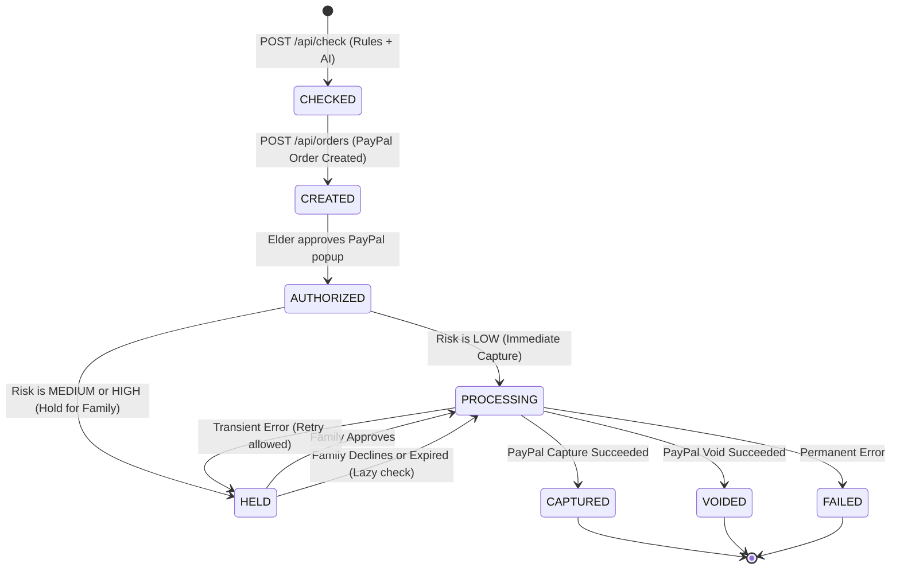
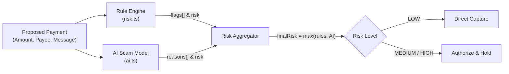

# Second Sight — System Architecture

**Tagline:** "Pause the payment. Not the person."

---

## 1. System Overview

Second Sight is an intelligent payment safety layer built on top of PayPal's Orders v2 API and generative AI. It acts as an empathetic security guard: normal payments complete instantly, but suspicious or high-pressure transactions are held in an authorized, uncaptured state until a trusted family member can review them.

```
+------------------------+      +-----------------------------------------+
|   ELDER FRONTEND       |      |  FAMILY DASHBOARD                       |
|   (React + Vite)       |      |  (React + Vite)                         |
|   - Big Text & Voice   |      |  - AG Grid (Transaction Logs)           |
+-----------+------------+      |  - Bryntum (Cooling-off Timeline)       |
            |                   +-------------+---------------------------+
            +---------------------------------+
                             |
                             v
               +----------------------------+
               |   EXPRESS SERVER           |
               |   (Node.js + TypeScript)   | <---- Hosted on Render
               +--------------+-------------+
                              |
         +--------------------+---------------------------+
         |            |             |          |          |
         v            v             v          v          v
    +---------+  +---------+   +--------+  +-------+  +----------+
    | risk.ts |  |  ai.ts  |   | paypal |  | holds |  | webhooks |
    +----+----+  +----+----+   +---+----+  +---+---+  +----------+
         |            |            |           | 
  +------+-----+      |            |           +-> [ notify.ts ] (alerts)
  |  APIMatic  |      v            v
  |  Dev Portal|  +----------+ +-----------+ +----------+
  |  & SDKs    |  | LLM API  | |  PayPal   | | MongoDB  |
  +------------+  +----------+ |  Sandbox  | |  Atlas   |
                               +-----------+ +----------+
```

---

## 2. Core Architectural Principles

1. **AI Advises, Code Decides:** The AI model is strictly an analytical advisor. Financial decisions (authorizing, capturing, voiding) are governed entirely by deterministic backend code.
2. **Authorize-First Money Flow:** Rather than charging the account and issuing a refund, Second Sight uses PayPal's `AUTHORIZE` flow. Funds are reserved on the buyer's account without moving to the seller.
   - If approved: the server triggers `CAPTURE` (money moves).
   - If declined or expired: the server triggers `VOID` (reservation is released immediately with zero transaction fees).
3. **Dignity-First User Experience:** Older adults are never labeled with "Fraud Detected" or "Account Blocked." The interface calmly reassures them: *"Paused for a second look. We asked your family to confirm."*
4. **Asymmetrical Visibility:** The elder screen receives only a status update. The secure `holdToken` and approve/decline endpoints are strictly isolated to the family member's dashboard to prevent pressured elders from approving their own scams.

---

## 3. Payment State Machine



### State Definitions
- **CHECKED:** Transaction pre-checked by rules and AI. Amount, payee, and reasons locked in MongoDB.
- **CREATED:** PayPal order initialized with `intent: "AUTHORIZE"`.
- **AUTHORIZED:** Elder completed PayPal popup. Funds reserved.
- **HELD:** High or medium risk payment paused awaiting family decision.
- **PROCESSING:** Atomic lock state preventing double capture/void race conditions.
- **CAPTURED:** Payment finalized; funds transferred to payee.
- **VOIDED:** Authorization cancelled; zero funds moved.
- **FAILED:** Irrecoverable PayPal or network failure.

---

## 4. Dual-Check Risk Pipeline



1. **Rule Engine (`risk.ts`):** Fast, deterministic regex & threshold evaluation:
   - Amount exceeds configured `FamilyLink.amountLimit` (default \$100).
   - High-danger keywords (gift card, wire, cryptocurrency, arrest, IRS, police, lottery, remote access, keep secret).
   - New or unknown payee label.
2. **AI Semantic Engine (`ai.ts`):** Contextual reasoning over the message and payee context using structured JSON output validated by Zod:
   - Detects emotional pressure, impersonation, urgency, and secrecy cues.
   - Generates a calm question for the elder.
   - Summarizes the scam context clearly for the family member.
3. **Fail-Safe Mechanism:** If the AI model times out, errors, or produces invalid schema output, the system sets `aiFailed: true` and defaults to `MEDIUM` risk (fails closed).

---

## 5. Concurrency & Safety Controls

- **Atomic State Transitions:** Uses MongoDB `findOneAndUpdate({ _id: paymentId, status: "HELD" }, { status: "PROCESSING" })`. Only one worker/request can process the hold.
- **Idempotency Headers:** Injects a unique `PayPal-Request-Id` UUID header on every `capture` and `void` API request.
- **Server Authority:** The payment amount, currency, and recipient are loaded exclusively from the database record during order creation. The client cannot tamper with the amount post-risk-check.
- **Lazy Expiry:** To support serverless / sleeping free-tier deployments on Render, every incoming request to `GET /api/holds` or `GET /api/payments/:id/status` identifies and voids expired holds (`expiresAt < now`). A background `setInterval` runs every 30 seconds as a secondary guard.

---

## 6. Data Model Schemas (MongoDB)

### User
- `name`: string
- `role`: `"elder"` | `"family"`

### FamilyLink
- `elderId`: ObjectId (`User`)
- `familyId`: ObjectId (`User`)
- `amountLimit`: number (default: 100)
- `createdAt`: Date

### Payment
- `elderId`: ObjectId (`User`)
- `familyId`: ObjectId (`User`)
- `amount`: number (USD)
- `currency`: `"USD"`
- `payeeLabel`: string (display name, e.g., "Plumber")
- `message`: string (elder's notes / message)
- `rulesResult`: `{ risk: string, flags: string[] }`
- `aiResult`: `{ risk: string, scamType: string, reasons: string[], questionForElder: string, familySummary: string }`
- `aiFailed`: boolean
- `risk`: `"LOW"` | `"MEDIUM"` | `"HIGH"`
- `paypalOrderId`: string
- `paypalAuthorizationId`: string
- `paypalCaptureId`: string
- `status`: `"CHECKED"` | `"CREATED"` | `"AUTHORIZED"` | `"HELD"` | `"PROCESSING"` | `"CAPTURED"` | `"VOIDED"` | `"FAILED"`
- `holdToken`: string (crypto-random UUID; family access only)
- `expiresAt`: Date
- `decision`: `"APPROVED"` | `"DECLINED"` | `"EXPIRED"` | null
- `decidedAt`: Date
- `createdAt`, `updatedAt`: Date
